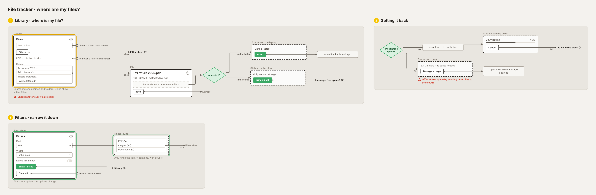
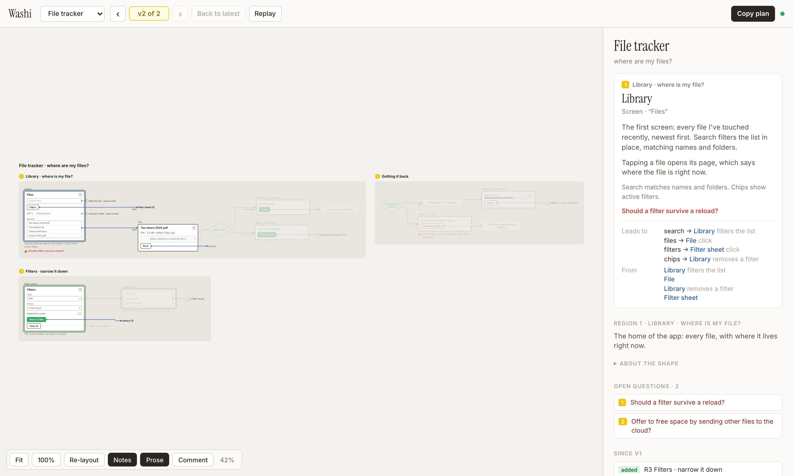

# Washi

Washi is a small tool for agreeing with Claude Code on how a feature works before any code gets written. Claude keeps a file in your project, and Washi draws it live as a flow diagram: the screens, the states, and where every tap leads. You can start from existing code or from nothing at all.



Describing a feature in prompts alone drifts. Each time, the agent pictures the app slightly differently, and you can't tell whether the flow changed or only the way it was described. Washi pins that picture down in a file that both of you can see and that keeps every version.

## A shape, not a spec

What Washi draws is a **shape**: a mid-level sketch of a feature, somewhere between a wireframe and a flow chart. It's built from a few pieces:

- **Regions** are numbered stages of the story, often phrased as a question ("Library · where is my file?").
- **Screens** are low-fi wireframe cards made of simple widgets: text, buttons, lists, a poster grid, a toggle.
- **Cut-outs** are dashed cards that show the variants of one slot, such as an item whose status depends on where it is.
- **Steps** say what the system does, and green **decisions** are the questions it asks.
- **Flows** tape it all together: every button says where it leads.

The shape lives in your project as a JSON file written in a fixed language: four node types and sixteen widgets, and the checker rejects anything else. That constraint is the point. The vocabulary can't drift, so two versions of a shape can be compared, and a change in the drawing means the feature changed, not the notation.

Clicking any part of the drawing shows what it is, why it behaves that way, where it comes from and where it leads. Open questions appear in red on the drawing itself, so what's still undecided stays in view.



## The loop

1. You describe a feature, or point Claude at existing code.
2. Claude writes the shape, and the viewer on your screen redraws it live.
3. Every valid save becomes a version (v1, v2, v3…). The viewer marks what was added, changed or removed since the previous one, so you review the change itself rather than the whole picture again. You can step back through versions or replay how the feature grew.
4. When something is off, you don't need a long prompt. Click the exact spot on the drawing, or drag a rectangle around an area, and leave a comment there. With **Send to Claude** checked, the comment goes straight to the session, which sees its precise location, such as "Library › Recent › Trip photos.zip". Leave it unchecked to collect several comments and send them later.
5. Claude answers in the comment's thread and saves the next version. The thread shows "Claude is working on it" until the answer arrives.

## Example: adding filters

[`examples/file-tracker.json`](examples/file-tracker.json) is a made-up app that keeps track of where your files are. A file is either on the laptop, ready to open, or only in cloud storage. If it's in the cloud, the app checks whether there's enough free space to bring it back, and says how much is missing if there isn't.

v1 is the whole first shape: a library, a file page, a decision (where is this file?) and a cut-out for each answer.

For v2 the prompt was a screenshot of a filter sheet and "add a similar interface and filtering experience". The new version gets:

- **Added:** a Filters button, a sheet of grouped options, and a picker that only offers values the library actually contains.
- **Changed:** the library screen gains a row of active-filter chips.
- **Open questions** on the drawing, such as whether a filter should survive a reload.

Both versions are in `examples/.history/`, so the viewer shows the diff and can replay it:

```bash
washi serve --root "" examples      # then open http://localhost:4747
```

## From shape to build

When the shape feels right, Washi turns it into a plan: a markdown file listing every region, screen, widget, decision and open question, and where each button leads. For a real app it came to 423 lines: everything there was to implement.

A shape can also be cut into **slices**, build increments such as "core screens", then "filters", then "sync". Each slice exports as its own plan, so you can hand each one to a separate agent working in parallel.

What stays behind is the JSON file in your project, with every version of it: how the app is meant to work, and how those requirements grew as they were implemented.

## Install

You need macOS or Linux, Python 3.9+ (standard library only), and [Claude Code](https://claude.com/claude-code). Google Chrome or Chromium is optional; Claude uses it for `washi shot` to look at its own drawing. The viewer loads its layout engine ([ELK](https://eclipse.dev/elk/)) and fonts from a CDN.

```bash
git clone https://github.com/jacopom/washi.git
cd washi
./install.sh ~/Projects      # the folder that holds your projects
```

`install.sh` does three things:

- links `washi` onto your PATH;
- links the Claude Code skill into `~/.claude/skills/washi`;
- on macOS, installs a LaunchAgent that keeps the viewer running at <http://localhost:4747>, watching every `~/Projects/*/washi/` folder.

On Linux, run `washi serve --root ~/Projects` yourself instead.

Then, in a Claude Code session inside one of your projects, ask it to shape something, for example "shape the onboarding flow with washi". Shapes live in `<project>/washi/<slug>.json`.

## CLI

```bash
washi serve [--root DIR] [--port N] [DIRS...]   # the viewer
washi check FILE                 # validate; warnings for dead buttons, unreached screens…
washi md FILE [--slice S1]       # export the build plan as markdown
washi shot NAME [--region R2]    # PNG of the drawing (Claude uses this to check its work)
washi watch                      # print comments as they're sent from the viewer
washi comments FILE [--all]      # list comments and their threads
washi reply FILE ID TEXT         # answer in a comment's thread
washi resolve FILE ID [TEXT]     # resolve, optionally with a last reply
washi reopen FILE ID
washi delete FILE ID
washi relayout FILE [--region R1]   # forget saved positions and lay out fresh
```

The full language reference is in [`skill/SKILL.md`](skill/SKILL.md), which is what Claude reads.

## Files next to a shape

```
<project>/washi/<slug>.json                 the shape
<project>/washi/<slug>.comments.json        comments and their threads
<project>/washi/.history/<slug>/NNNN.json   every valid version
<project>/washi/.history/<slug>.layout.json where each node sits, so layouts stay put between versions
```

All of them are worth committing.

## Privacy

Everything stays on your machine. The viewer listens on `127.0.0.1` only, and it refuses requests from other websites, since comments end up in Claude's context. Comments sent to Claude go through a local file (`~/.washi/outbox.jsonl`) that `washi watch` reads.

## License

[MIT](LICENSE)
